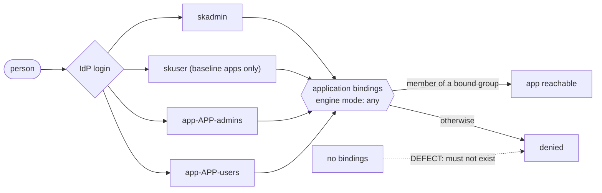

# Application Access Through SSO Standard

**Status:** PROPOSED. Ecosystem standard for every web application, admin tool and
dashboard that a human reaches through the estate identity provider (IdP).
**Date:** 2026-11-10
**Scope:** who may open an application. Not what they may do once inside a `sk*`
subapp (that is [`SKWORLD_AUTHORIZATION_STANDARD`](./SKWORLD_AUTHORIZATION_STANDARD.md)),
not how a subject is spelled ([`IDENTITY_NAMING_STANDARD`](./IDENTITY_NAMING_STANDARD.md)),
and not how traffic reaches the box ([`UNIFIED_INGRESS_STANDARD`](./UNIFIED_INGRESS_STANDARD.md)).

> One sentence: **an application admits nobody until a group admits them, access is
> granted by adding a person to a group and never by touching the application, and an
> empty binding list is a defect, not a default.**

---

## 1. Why this exists: an empty binding list admits everyone

The IdP in the reference estates is Authentik 2026.x. Applications sit behind a Traefik
forward-auth middleware served by one embedded outpost, or carry their own OIDC or
proxy provider. A live audit on 2026-11-10 found three defects that share one root.

| Finding | Effect |
|---|---|
| The domain-wide forward-auth "catch-all" provider had **no policy binding**. In Authentik, an application with no bindings admits every authenticated user. | Any authenticated account, including about 27 accounts that existed only for a community file-sharing app, could pass forward auth for admin tools: metrics, sync, the ingress dashboard, and others. |
| Several provider applications (a hypervisor console, a remote-control tool) had no bindings either. | Same: open to every authenticated user. |
| Portal tiles were bound to the IdP's own `authentik Admins` group. | A human in the estate admin group `skadmin` could see 11 of 39 applications, so the tile list and the real access rules disagreed in both directions. |

There was also no general user group and no user-level test identity, so nobody could
prove "a normal user cannot open this" because no normal user existed.

The root cause is the default, not a typo. A binding list is an allow-list that
**falls open when empty**. This standard replaces that default with an explicit access
mode on every application, and a check that fails on any application whose bindings do
not match its declared mode.

---

## 2. The model



Rules in one place:

1. **Groups are the only grant.** A person gets access to an application by joining a
   group. A binding to an individual user is a defect (section 4.3).
2. **`authentik Admins` is reserved.** It administers the IdP itself and holds
   automation accounts. It is never bound to an application, never a tile group, and
   never named in an OIDC role mapping. Human administrators of the estate belong to
   `skadmin`.
3. **Two global groups**, `skadmin` (admin everywhere) and `skuser` (an optional
   baseline bundle of default applications, never admin) (section 3.1).
4. **Two groups per application**, `app-<app>-admins` and `app-<app>-users` (section 3.2).
5. **Every application declares exactly one access mode** (section 5), and its
   bindings are derived from that mode, never written by hand.
6. **Fail closed.** No declared mode, no bindings, or a binding list that does not match
   the mode: denied, and reported by the check in section 9.

---

## 3. Groups

### 3.1 Global groups

| Group | Meaning | Members |
|---|---|---|
| `skadmin` | Estate administrators. Pass the gate of **every** application, as an administrator. | Humans who administer the estate. Few, named, reviewed. |
| `skuser` | An optional **baseline bundle**: the estate's default application set. Joining it gives a person user-level access to every application that declares `in_baseline: true`, and nothing else. It never grants admin and never reaches an application outside the baseline. | Whoever should get the default set in one step, and the user-level test identity (section 8.5). |
| `authentik Admins` | The IdP's own administrators. See rule 2. | Automation accounts and the people who administer the IdP. |

There are two first-class ways to provision a person, and a person may use both:

1. **Baseline:** add them to `skuser`. They reach the baseline applications.
2. **A la carte:** add them to individual `app-<app>-users` groups. No `skuser`
   membership is needed.

Neither path implies the other. Membership in `skuser` is not required for any
application, and an application outside the baseline is unreachable through `skuser`.

Other existing groups (support, editor, read-only and similar role groups) are
**application roles**, not access groups. They may stay, but no application may rely on
one of them as its gate. A gate is `skadmin`, `skuser`, or an `app-<app>-*` group.

### 3.2 Per-application groups: `app-<app>-admins` and `app-<app>-users`

Chosen spelling: `app-<app>-admins` and `app-<app>-users`, where `<app>` is the
application's Authentik slug.

Why the `app-` prefix rather than the shorter `<app>-admins`:

- **Disjoint namespace.** Existing groups in an estate are named for people and roles
  (`skadmin`, a support group, a hub-users group). An unprefixed `<app>-users` can
  collide with a role group by accident, and a slug such as `authentik` would produce
  `authentik-admins`, one character from the reserved `authentik Admins`. The prefix
  makes the two namespaces disjoint, the same reason
  [`IDENTITY_NAMING_STANDARD` section 1](./IDENTITY_NAMING_STANDARD.md#1-canonical-grammar-normative-schema)
  gives for the `sk` prefix on service local-parts.
- **One pattern for tooling.** Every per-application group matches
  `^app-[a-z0-9]+(-[a-z0-9]+)*-(admins|users)$`, so the check, the offboarding script and
  the access review select them with one expression and need no list of application names.
- **Parseable in both directions.** Group to application: strip `app-` and the suffix.
  Application to groups: concatenate. An application slug MUST NOT itself end in
  `-admins` or `-users`.

Alignment with identity naming: group names are **not** subjects. They never appear in
a `decide()` call, never in `actor.id`, and are never a substitute for an fqid. They use
the same lowercase ASCII, hyphen-delimited style so the two grammars look alike, and
nothing more. The username of a human account SHOULD equal the local part of that
person's fqid so a person is one string everywhere.

Pre-existing groups that already fit `<app>-users` (a hub-users group is the known
case) are legacy spellings. Rename them with the dual-name approach in section 10, or
record an explicit exception. Do not run both names indefinitely.

### 3.3 How the global groups relate to the per-application groups

Decision: **bind `skadmin` directly on every application's gate, and bind `skuser`
directly on every baseline application's gate.** Do not model either relation with
group parents.

| Option | Verdict |
|---|---|
| Direct binding: each application's bindings list `skadmin` and `app-<app>-admins` (engine mode `any`). | **Chosen.** Visible on the application, evaluated the same on every version, auditable by one API call. |
| `skadmin` as child of every `app-<app>-admins`. | Not possible as stated: an Authentik group has one parent field, so `skadmin` cannot be a child of 39 groups. |
| Each `app-<app>-admins` as child of `skadmin`. | Pushes the wrong way if membership inherits upward: members of one application's admin group could count as `skadmin`. A privilege escalation by hierarchy. |
| Membership in both (add every `skadmin` person to every `app-<app>-admins`). | Rejected: 39 times the membership to maintain and to review, and it drifts. |

The same reasoning settles `skuser`. Making `skuser` the parent of each baseline
application's `-users` group would fit the single-parent limit, but it ties the
baseline to inheritance semantics that differ by release: if membership inherits
upward, members of one application's `-users` group would count as `skuser` and reach
every other baseline application. A direct `skuser` binding says exactly what it does,
is listed on the application, can be removed by editing one application, and is
checked by one API call. It costs one extra binding per baseline application.

Parents may be used for **organisation** (cosmetic folders) but MUST NOT carry access.
This choice rests on the single-parent field and on inheritance direction. Both are
Authentik behaviours that change between releases, so the conformance probe (section 9,
check C6) tests the actual outcome and not the model.

Direct binding has one consequence the OIDC mapping must respect: a `skadmin` member
is not a member of `app-<app>-admins`, and a `skuser` member is not a member of
`app-<app>-users`, so role mappings list both (section 7).

---

## 4. Bindings

### 4.1 What a binding set looks like

Every application's binding set is the output of its access mode (section 5) with
policy engine mode `any`. The groups are bound as **group bindings**, enabled, not
negated, with no timeout surprises:

| Mode | Bindings (engine mode `any`) |
|---|---|
| `admin-only` | `skadmin` |
| `app-groups` | `skadmin`, `app-<app>-admins`, `app-<app>-users` |
| `app-groups` with `in_baseline: true` | the three above **plus** `skuser` |
| `any-account` | one named allow-all policy, `sso-allow-any-account` |
| `public` | one named allow-all policy, `sso-allow-public`, **and** an exemption record |

`public` and `any-account` deliberately carry a binding. They are **not** represented
by an empty list, because an empty list must always mean "someone forgot".

### 4.2 The domain-wide catch-all

The catch-all forward-auth provider's application is `admin-only`. Any application that
has no provider of its own therefore defaults to admins only, which is the correct
failure.

Consequence: **a catch-all-backed application can only be `admin-only`.** The
catch-all decides before the application's own tile or groups are consulted, so
`app-<app>-users` members would see a tile and then be denied. Any application that
needs non-admin users MUST have its own provider (a per-host forward-auth provider, or
its own OIDC or proxy provider) with its own bindings. The outpost must select the
per-host provider over the domain-wide one for that host; verify that on the deployed
version rather than assuming it (check C7).

### 4.3 Forbidden bindings

The check fails on all of these:

- zero bindings (C1);
- a binding to `authentik Admins` (C2);
- a binding to a single user (C3), because it is invisible to the group review;
- a disabled binding being the only binding, or a negated binding on a gate (C4);
- an engine mode of `all` on a multi-group gate (C5), which would require membership
  in every group at once.

---

## 5. Access modes

Every application declares one mode in its deployment definition (section 6). The mode
is a property of the application, reviewed in the PR that adds it.

| Mode | Who passes | Needs exemption record | Use for |
|---|---|---|---|
| `admin-only` | `skadmin` | No | Infrastructure and operator tools: metrics, sync, ingress dashboard, anything run on the catch-all. **The default.** |
| `app-groups` | `skadmin`, `app-<app>-admins`, `app-<app>-users`, and `skuser` only if `in_baseline: true` | No, but every `in_baseline` application is listed in each access review | Applications people are provisioned into one at a time, optionally part of the default bundle. Needs its own provider if it is not behind the catch-all. |
| `any-account` | Any authenticated IdP account | **Yes** | An application for a wider audience than estate staff, such as a community file-sharing app, which then does its own authorization. |
| `public` | Everyone, with no IdP gate | **Yes** | A genuinely public page. The route carries no forward-auth middleware, or the provider application carries the allow-all policy. |

`in_baseline` is a flag on `app-groups`, not a mode. It is `false` unless declared, it is
not allowed on `admin-only`, and `skuser` never carries admin: an `in_baseline`
application's admin role is still mapped only from `skadmin` and `app-<app>-admins`.
There is no separate "every estate user" mode: that is `app-groups` with the baseline
flag, so an account outside `skuser` (such as a community account) is excluded.

The two modes that widen beyond the estate (`any-account`, `public`) are the
**reviewed opt-outs**. An exemption record states: the mode, a one-line reason, the
named owner, the date approved, and a **review date no more than 12 months out**. The
check fails on a missing record and on an expired review date. Approval is an ITIL
change per
[`ITIL_AND_RUNBOOK_OPERATING_MODEL_STANDARD`](./ITIL_AND_RUNBOOK_OPERATING_MODEL_STANDARD.md),
because widening who can reach an application is exactly the kind of change a CAB exists
to see.

Federation endpoints that are public by design under
[`UNIFIED_INGRESS_STANDARD` section 7](./UNIFIED_INGRESS_STANDARD.md#7-the-capauth-gate-middleware)
stay public and stay on that standard's allowlist. They are not an application under
this standard, and the IdP forward-auth middleware MUST NOT sit in front of them.

---

## 6. One declaration per application

Everything below is derived from a single block, so the tile, the bindings, the groups
and the OIDC mapping cannot disagree. This is the SKStacks portal-tile contract
extended, not a second file.

```yaml
# per-application deployment definition (illustrative, generic names)
access:
  mode: app-groups            # admin-only | app-groups | any-account | public
  in_baseline: false          # true: also bind skuser (app-groups only)
  provider: own               # catch-all | own
  groups:
    admins: app-<app>-admins  # derived, never typed by hand
    users:  app-<app>-users
  oidc_roles:                 # only if the app maps groups to roles
    admin: [skadmin, app-<app>-admins]
    user:  [app-<app>-users] # plus skuser when in_baseline: true
  exemption: null             # required for any-account and public (section 5)
```

Derivation rules:

- **Bindings** come from the mode table in section 4.1.
- **The portal tile** is bound to the same groups that pass the gate, so a tile is
  visible if and only if the person can open the application. A tile bound to a group
  the gate does not admit, or a gate group missing from the tile, is a defect (C8). This
  supersedes a single fixed tile group: the SKStacks role variable
  `AUTHENTIK_TILE_GROUP` is a default for `admin-only`, not a value for every mode.
- **OIDC role mapping** comes from `oidc_roles` (section 7).
- **Group creation** runs when the application is added, so groups exist before anyone
  needs them (section 8.1).

---

## 7. OIDC role mapping

An application that maps OIDC groups to roles (an admin role, a user role) MUST map:

- its admin role from `skadmin` and `app-<app>-admins`;
- its user role from `app-<app>-users`, and also from `skuser` when the application is
  `in_baseline`. `skuser` is never an input to the admin role.

It MUST NOT map any role from `authentik Admins`. Where a role map is a comma-separated
variable (for example `OIDC_ADMIN_GROUPS`), the value is generated from `oidc_roles`
above, not edited by hand. Because `skadmin` is bound directly (section 3.3), omitting
it from the admin list makes an estate administrator a plain user inside the
application, even though the gate let them in.

Caution: whether the `groups` claim lists inherited groups depends on the IdP version,
a second reason not to rely on parents. A login that maps to no role MUST get the
least privileged role, never admin.

Application-side authorization is still the application's job. A `sk*` subapp keeps its
`decide()` lifecycle under
[`SKWORLD_AUTHORIZATION_STANDARD`](./SKWORLD_AUTHORIZATION_STANDARD.md): an SSO group
answers "may this person reach the application", the PDP answers "may this subject do
this action". A group name MUST NOT be passed to `decide()` as a subject.

---

## 8. Lifecycle

### 8.1 Adding an application

1. Add the `access:` block (section 6) in the same PR that adds the application.
2. Deploy: the role creates `app-<app>-admins` and `app-<app>-users`, creates the
   provider if `provider: own`, writes the bindings and the tile.
3. The release gate (section 9.3) runs the probe for the declared mode. No pass, no
   release.

Groups are created for every application so provisioning is ready. They only take
effect in `app-groups` mode. Members of an application's groups while its mode is
`admin-only` are an **ineffective grant**: access the person believes they have and
do not (check C9). Fix it by changing the mode or by emptying the group.

### 8.2 Onboarding a person

Through the IdP portal, by **group membership only**:

1. Create the account.
2. Either add it to `skuser` for the baseline set, or add it to the
   `app-<app>-users` group of each application it needs, or both. Add it to
   `app-<app>-admins` for administrators of that application.
3. Add to `skadmin` only for estate administrators, and only on a named approval.

No application, binding or provider is touched. If onboarding someone requires editing
an application, the model has a gap: file a defect against this standard.

### 8.3 Offboarding

Same day as the departure:

1. Set the account inactive and revoke its sessions and tokens. Delete only after the
   estate's retention window, so the audit trail survives.
2. Remove it from every group (`app-*`, `skuser`, `skadmin`), one loop.
3. If it held `skadmin` or any `app-<app>-admins`, rotate the local credentials it could
   have read (API tokens, local admin passwords, OIDC client secrets).
4. Record it as a change.

### 8.4 Access review

Quarterly, and after any incident touching identity:

- list every member of `skadmin` and every `app-<app>-admins`, and confirm each is
  current;
- list every `in_baseline` application, every member of `skuser`, and every exemption,
  and confirm the baseline set and the review dates;
- list ineffective grants (C9) and empty groups with no explanation;
- list accounts in no group, and accounts not in `skuser`, and confirm each is
  intentional (the community accounts of the audit are exactly this population).

The review output is a dated record, attached to a change, not a chat message.

### 8.5 Test identities

Each estate has two **test accounts**, so both halves of "who can" and "who cannot" are
testable:

| Account | Groups | Purpose |
|---|---|---|
| user-level test account | `skuser` only. No `skadmin`, no `authentik Admins`, no `app-*` group. | Proves the baseline: **allowed** on every `in_baseline` application, **refused** on every non-baseline application, and **refused** wherever admin is required. |
| admin-level test account | `skadmin` only. **Not** `authentik Admins`. | Proves **allowance**: it must reach every application the admin group is meant to reach. |

Rules for both:

- Credentials live in the estate vault, under entries named for the role, never in a
  repository, a unit file or a CI variable that is echoed. Rotate on the same schedule
  as other privileged credentials and after any person with vault access leaves.
- They are for probes only. Nobody signs in as them to do real work; their sign-ins are
  expected to come from the probe host, and a sign-in from elsewhere is an alert.
- The admin-level account is the reason the user-level one can be trusted: a probe where
  only the user account is refused would pass on an application that is simply down.

An application in `app-groups` mode MAY add a further probe: a temporary membership of
the user-level account in that application's `-users` group for the duration of the
release gate, removed afterwards, to prove the app-group path itself.

---

## 9. Conformance

### 9.1 The check (the script)

A conformance script reads every application from the IdP API and fails on any
violation. It needs a read-only API token held in the vault and the IdP address as a
parameter. It has no estate-specific content and is the same script in every estate.

```text
sso-access-check --idp <idp-url> --declarations <path>
  exit 0  every application conforms
  exit 1  at least one violation (one line per violation: <slug> <check> <detail>)
  exit 2  the check could not run (API unreachable, token refused, zero applications
          returned). A check that saw nothing MUST NOT report clean.
```

The core loop: list every application (following pagination to the end), list each
one's bindings, and apply checks C1 to C10 below. Field names for bindings, groups and
the application primary key must be confirmed against the pinned IdP version before the
script is trusted.

### 9.2 Checks

| Id | Fails when |
|---|---|
| C1 | An application has zero enabled bindings. Applies to the catch-all, to provider applications, and to provider-less tiles. |
| C2 | Any binding, tile group, or OIDC role mapping names `authentik Admins`. |
| C3 | A binding targets a single user. |
| C4 | The only binding is disabled, or a gate binding is negated. |
| C5 | A multi-group gate uses engine mode `all`. |
| C6 | The bindings differ from what the declared mode derives (missing `skadmin`, wrong groups, `skuser` bound on an application that is not `in_baseline`, or missing on one that is), or a declared `public` or `any-account` application lacks a valid, unexpired exemption record. |
| C7 | An application is not `admin-only` but rides the catch-all provider. |
| C8 | A portal tile's groups differ from its gate groups. |
| C9 | An `app-<app>-*` group has members while the application's mode is `admin-only`, or an application has no declared `access:` block at all. |
| C10 | A required group (`skadmin`, `skuser`, or a declared `app-<app>-*` group) does not exist, or a group named `app-*` exists for no declared application. |

The test for the check is the usual one in
[`TESTING_AND_CI_STANDARD` section 6](./TESTING_AND_CI_STANDARD.md): the check ships with
a negative control that creates an application with no bindings in a scratch IdP, or
replays a recorded API response containing one, and proves exit 1. A checker that has
never been seen to fail is not evidence.

### 9.3 The probe (the release gate)

The check proves the configuration. The **probe** proves the outcome, by logging in as
the test accounts and requesting every application.

Expectations, derived from the declared mode:

| Mode | Admin-level test account | User-level test account |
|---|---|---|
| `admin-only` | reaches the application | **refused** |
| `app-groups`, not in baseline | reaches the application | **refused** (until the optional extra probe adds it) |
| `app-groups`, `in_baseline: true` | reaches the application | reaches the application as a user, and is **not** an admin in it |
| `any-account` | reaches the application | reaches the application |
| `public` | reaches the application | reaches the application, with no login |

Rules for the probe:

- It authenticates through the IdP's own flow, not through a shortcut, so a gate that
  forward auth enforces is the gate being tested.
- **A refusal only counts when the same application was reached by the admin-level
  account in the same run.** This closes the false pass of an application that is down.
- "Reached" means a 2xx from the application itself. "Refused" means any outcome that is
  not the application's own content: a 401 or 403, a redirect back to a login or denied
  page. Which of those the IdP produces differs by provider type and release, so the
  probe asserts on the application's absence, not on one status code.
- A mode, binding or group change that turns a probe red blocks the release. The probe
  and the check run on every deploy of an application and nightly for the estate.

### 9.4 Rollout

Per the repo's own rule,
[`DOCS_FRESHNESS_STANDARD` section 2](./DOCS_FRESHNESS_STANDARD.md): green on day one.
Land the compliance pass for an estate (every application declared, every defect
fixed) before turning the check into a failing gate. Until then the check runs as
report-only and the report is reviewed weekly.

---

## 10. Migration notes

For an estate adopting this standard, in this order. Each step is reversible.

1. **Create `skuser` and the test accounts.** Decide the baseline set. Add people to
   `skuser` only if they should get it; nobody has to be in it.
2. **Bind the catch-all to `skadmin`.** This is the fail-closed step and the one that
   can lock people out. First list who relies on a catch-all-backed application and is
   not in `skadmin`, then add them or promote that application to its own provider with
   `app-groups`.
3. **Bind every provider application** with a mode, replacing empty lists.
4. **Move tiles and OIDC maps off `authentik Admins`** to the derived groups.
5. **Rename legacy `<app>-users` groups** to `app-<app>-users`: create, copy members,
   repoint bindings and role maps, run the probe, delete the old group. Never keep both.
6. **Turn the check on** as report-only, then as a gate once green (section 9.4).

What can turn red: an application whose real users are in no gate group, a role map
still naming `authentik Admins`, and an application on the catch-all that someone
expected non-admins to reach.

---

## 11. Compliance checklist (per application)

- [ ] The application has an `access:` block with exactly one mode (section 5).
- [ ] The bindings equal what the mode derives, with engine mode `any` (section 4.1). No empty list.
- [ ] No binding, tile or role mapping names `authentik Admins`.
- [ ] No binding targets a single user.
- [ ] `skadmin` is bound directly, wherever the mode admits administrators.
- [ ] `skuser` is bound if and only if the application is `app-groups` with `in_baseline: true`, and never reaches admin.
- [ ] A non-`admin-only` application is not behind the catch-all provider.
- [ ] `app-<app>-admins` and `app-<app>-users` exist and match the naming pattern (section 3.2).
- [ ] The portal tile is bound to the same groups as the gate.
- [ ] OIDC role maps, if any, are generated from the declaration and name `skadmin` and `app-<app>-admins` for admin.
- [ ] `any-account` and `public` carry an approved, unexpired exemption record.
- [ ] The release probe passes for the declared mode, including the refusal paired with the admin success.
- [ ] The conformance check is green for this application.
- [ ] The application's own authorization still runs for in-app actions (no group name reaches `decide()`).

---

## Related standards

- [SKWORLD_AUTHORIZATION_STANDARD](./SKWORLD_AUTHORIZATION_STANDARD.md): what a subject
  may do inside a subapp. This standard decides who reaches the door; that one decides
  what they may do inside. SSO groups are coarse access, never PDP subjects.
- [UNIFIED_INGRESS_STANDARD](./UNIFIED_INGRESS_STANDARD.md): how traffic reaches the
  proxy. The forward-auth middleware here sits at the reverse-proxy layer it describes,
  and public-by-design federation paths stay outside it.
- [IDENTITY_NAMING_STANDARD](./IDENTITY_NAMING_STANDARD.md): how subjects are spelled.
  Group names are not subjects and follow a parallel lowercase ASCII style.
- [TESTING_AND_CI_STANDARD](./TESTING_AND_CI_STANDARD.md): gate integrity (a check must
  be shown able to fail) and release gating.
- [ITIL_AND_RUNBOOK_OPERATING_MODEL_STANDARD](./ITIL_AND_RUNBOOK_OPERATING_MODEL_STANDARD.md):
  the change record that every exemption, mode widening and `skadmin` addition needs.
- [SK_REPO_DOC_STANDARD](./SK_REPO_DOC_STANDARD.md): the SOP of a deploying repo
  documents its `access:` block and runs the check.

---

*License: Apache-2.0. Part of [sk-standards](../README.md).*
