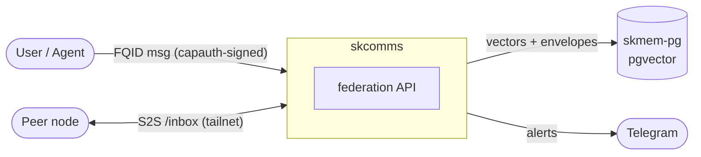
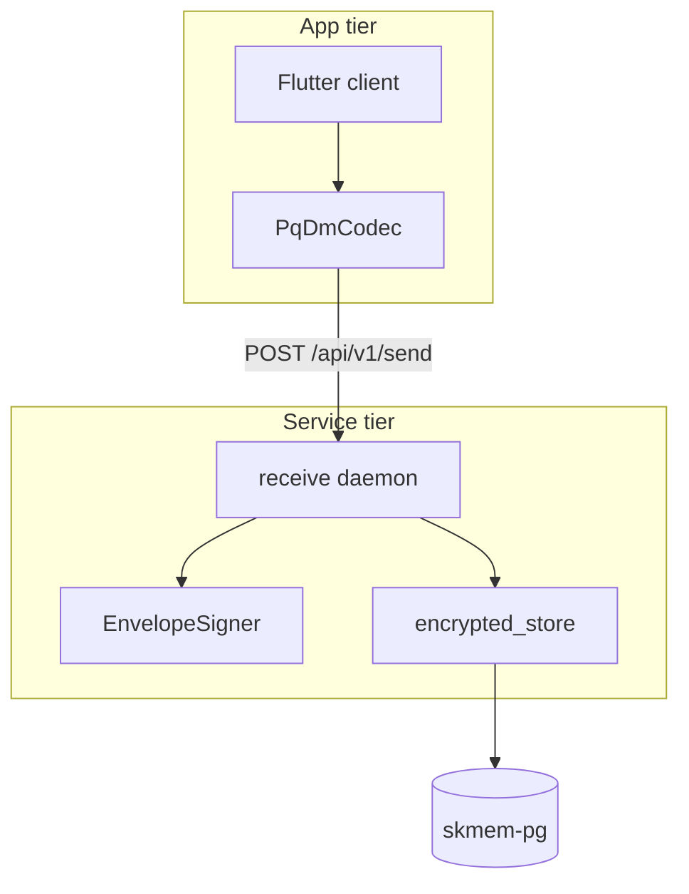
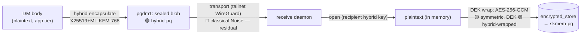
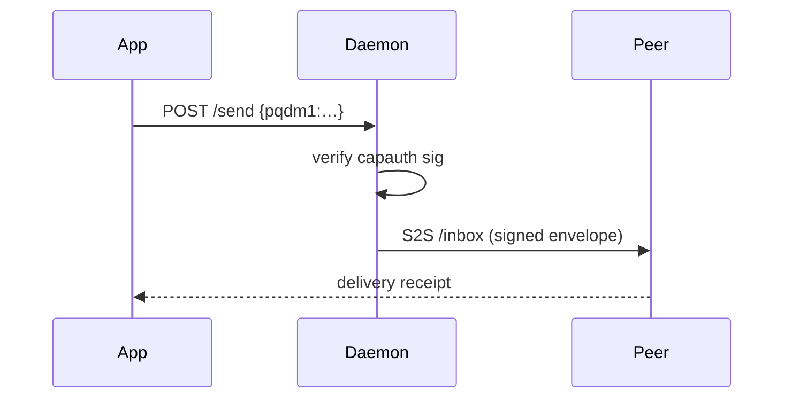

# SK Architecture & Data-Flow Standard

**Status:** Ecosystem standard for all `sk*` repos. Companion to
[`SK_REPO_DOC_STANDARD`](./SK_REPO_DOC_STANDARD.md) and
[`CRYPTOGRAPHY_STANDARD`](./CRYPTOGRAPHY_STANDARD.md).

**Why:** A new contributor — **AI agent or human** — should be able to understand
*what this service is, what data flows through it, and where to start reading* in
**under five minutes**, from the repo alone. Diagrams that live next to the code,
in text, are the cheapest way to keep that true. This standard says which diagrams
every repo owes, and how to draw them.

---

## Tooling: mermaid first, draw.io only when you must

| | mermaid | draw.io (`.drawio`) | Archify |
|---|---|---|---|
| Format | **text** (markdown-embedded) | XML | **text** (JSON source) |
| Git diff / review | ✅ line-level | ⚠️ noisy | ✅ line-level (JSON source) |
| Renders on GitHub / in-repo | ✅ inline | ❌ (needs export) | ❌ (self-contained HTML, no inline markdown render) |
| **AI can read & regenerate it** | ✅ | ⚠️ awkward | ✅ (JSON-IR against a published schema) |
| Stays in sync with code | ✅ (edit in the PR) | ✗ (drifts) | ✅, when regenerated in the same PR as the source mermaid |
| Precise hand-tuned layout | ⚠️ limited | ✅ | ✅ (auto-layout, hand-tunable) |
| Interactive (pan/zoom, search, export) | ❌ | ❌ | ✅ |
| Source-linked | n/a | n/a | ✅ (JSON source always checked in beside the HTML) |

**Rule:** Use **mermaid by default** — it's the SK house diagram language. Reach for
**draw.io only** for a large hand-tuned canvas that mermaid can't express; when you
do, commit the `.drawio` **and** an exported `.svg` (so it renders without the tool),
under `docs/diagrams/`. Never commit a diagram as a bare PNG with no source.

### Interactive companion diagrams (optional)

Mermaid stays **canonical and mandatory**: it renders inline on GitHub, Forgejo,
editors, and the hub, and it is what an AI agent reads and regenerates. Nothing in
this subsection changes that; an interactive companion is an addition, never a
substitute.

An [Archify](https://github.com/tt-a1i/archify) view is an **optional, derived**
artifact for the app's `-skworld-io` site and its onboarding pages, where a reader
benefits from an explorable, pannable diagram and a static image would not be enough.

- Its JSON source **and** the self-contained HTML it renders both get committed:
  under `docs/diagrams/` in the code repo, and under `diagrams/` in the site repo
  (the `-skworld-io` counterpart). Never commit a bare Archify HTML with no JSON
  source beside it, the same rule the draw.io row above already holds every repo to.
- It is **regenerated in the same PR** that changes the mermaid diagram it was
  derived from, using Archify's mermaid-input authoring mode: read the mermaid for
  topology and meaning, then author fresh Archify JSON rather than mechanically
  rendering mermaid styling. A companion diagram that outlives the mermaid it was
  drawn from is worse than no companion diagram at all.
- The companion tool's update-check network call stays **disabled** for every
  generation; a pinned, reviewed install never phones home to decide what to render.
- The site links to the HTML in a new tab and shows a PNG export of it inline, so
  the page still carries the content for a reader who never opens the interactive
  view.

#### Required for every `-skworld-io` site repo

The paragraphs above make an Archify companion optional for a code repo. A site
repo (the `<name>-skworld-io` GitHub Pages counterpart of an sk* service) is held
to a stricter floor, because the whole point of that repo is the reader-facing
page, not the source code:

- **`diagrams/<name>.architecture.json` is REQUIRED** in every `-skworld-io` site
  repo, committed with its generated `diagrams/<name>.architecture.html` beside
  it. `diagrams/<name>.dataflow.json` and `diagrams/<name>.workflow.json` (with
  their generated HTML) are optional, added only when the service actually has a
  multi-tier data flow or a release workflow worth showing, same pattern.
- **The generated HTML is committed, never built at serve time.** GitHub Pages
  for these sites serves static files from the branch; there is no build step at
  request time, so an uncommitted or stale HTML file is a broken page, not a
  pending build.
- **The site's nav and `docs.html` both link to every generated diagram**, each
  opening the interactive HTML in a new tab. `skpatch-skworld-io` is the
  reference implementation: see its `index.html` figure captions and
  `diagrams/` folder.
- **The Archify JSON is derived from the service repo's mermaid docs and MUST
  NOT contradict them.** Same components, same connections, same trust
  boundaries as the mermaid source named in the preceding rule. A PR that adds
  or edits a site's Archify JSON without the service repo's mermaid already
  covering the same shape fails review on this point. This is the review check:
  the reviewer opens the regenerated HTML next to the current mermaid and
  confirms neither contradicts the other before approving.
- **Authoring guide:** [`archify-diagrams.md`](./archify-diagrams.md) has the
  schema essentials, the exact pinned local regeneration command, the reusable
  CI workflow call, and this rule's checklist row.
- **Template:** a new site repo starts from
  [`templates/site/diagrams/example.architecture.json`](../templates/site/diagrams/example.architecture.json),
  renamed to `<name>.architecture.json`.
- **CI enforcement:** the site repo's `.github/workflows/archify.yml` calls the
  `archify-build` reusable workflow published from `smilinTux/.github`. It fails
  a pull request if the committed HTML is stale against its JSON, and on a push
  to `main` it regenerates and commits the HTML itself, so the committed HTML
  and its JSON source never drift apart.

---

## The required diagram set (every service repo)

A service repo's `SOP.md` (or a dedicated `docs/ARCHITECTURE.md`) MUST contain these
four, in this order. Libraries (sk_pqc/sk_pgp) owe #1 and #2 only (no multi-tier
data flow).

### 1. System context — "who talks to this?"
The service as one box, surrounded by the external actors/systems it exchanges data
with. One glance = the blast radius.

### 2. Component view — "what are the moving parts?"
Internal modules/services + datastores, and which module owns which surface. This is
where a reader learns the **entry points**.

### 3. Data-flow — "what data goes where, transformed how, protected by what" ⭐
**The highest-value diagram.** Trace each *important data type* from where it's
created, through every service/transform, to where it rests — and **annotate every
hop with (a) the transform and (b) the crypto posture** (`hybrid-pq` / `classical`
/ `symmetric` / `plaintext`) citing the [crypto standard](./CRYPTOGRAPHY_STANDARD.md).
This is what ties "data flow" to "security claim" — a reader sees *exactly* where a
payload is plaintext, where it's hybrid-sealed, and where a classical leg remains.

> Legend: 🟢 hybrid-pq · 🟡 symmetric (Grover-acceptable) · 🔴 classical (Shor-breakable,
> documented residual). Annotate **every** hop — silence reads as "covered" when it isn't.

**Data classification:** label each data type (public / internal / sensitive /
secret) on the flow so its protection requirement is self-evident.

### 4. Sequence — "how does the one critical flow actually happen?"
A `sequenceDiagram` for the 1–3 load-bearing end-to-end flows (e.g. send-a-message,
authenticate, rotate-a-key). Shows ordering, round-trips, and where failures branch.

---

## "Start here" — the onboarding section (required prose)

Diagrams show structure; a reader still needs a thread to pull. Every repo's overview
MUST include:

- **What this is, in 2 sentences** — the one job this repo does.
- **Key entry points** — the 3–5 files/functions to read *first*, each with a one-line
  "this is where X happens" (e.g. `signing.py:EnvelopeSigner` — outbound signatures).
- **The data it owns** — the durable state + where it lives (DB/table, files).
- **External dependencies & integration points** — what it calls, what calls it.
- **Maturity tier** (T0–T4 per the crypto standard) + current honest posture.

A good test: *could an AI agent, given only this overview + the diagrams, correctly
answer "where would I change how DMs are encrypted?" without reading the whole tree?*
If not, the overview is incomplete.

---

## Keeping diagrams honest & fresh

- Diagrams are **reviewed like code** — a PR that changes a data path updates the
  data-flow diagram in the same PR.
- The data-flow crypto annotations are bound by the [honest-claims rule](./CRYPTOGRAPHY_STANDARD.md):
  never paint a hop `hybrid-pq` unless its live suite is — an unmigrated leg stays
  `classical` on the diagram. The diagram is a *claim*, so it carries the same evidence bar.
  Label each hop with its **negotiated suite id** (`x25519-mlkem768` / `x25519-pgp-wrap-v1`),
  the self-describing tag from the [CRYPTO_AGILITY_STANDARD](./CRYPTO_AGILITY_STANDARD.md), so
  the colour is traceable to a real wire value, not a vibe.
- Prefer a few **accurate** diagrams over many aspirational ones.
