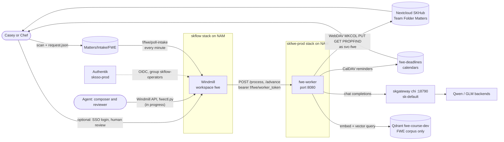
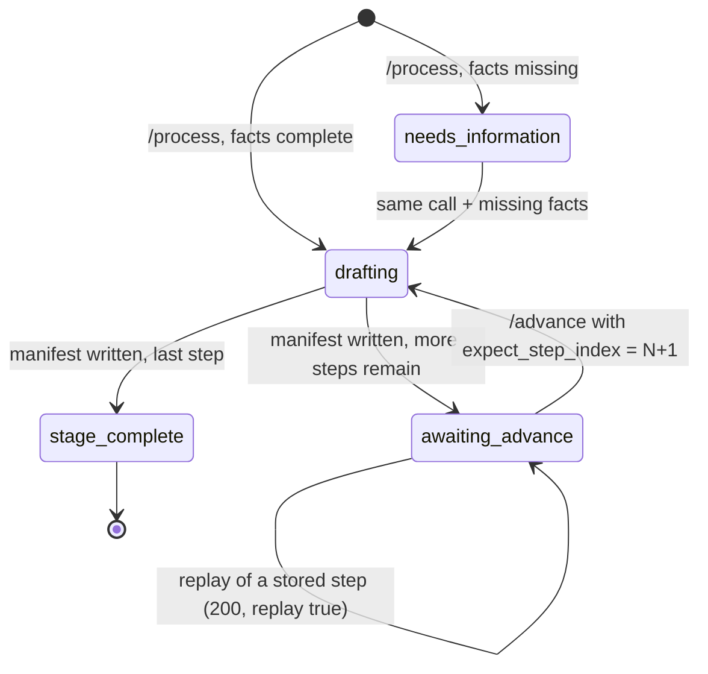

# FWE Matter Document Generation Standard

**Status:** Ecosystem standard for the Freedom with Equity (FWE) matter pipeline on
SKHub and Windmill. Companion to
[`FWE_AGENT_OPERATING_STANDARD`](./FWE_AGENT_OPERATING_STANDARD.md) (what an agent may
and may not do) and [`FWE_ONBOARDING_QUICKREF`](./FWE_ONBOARDING_QUICKREF.md) (URLs,
paths, commands). Follows [`ARCHITECTURE_AND_DATAFLOW_STANDARD`](./ARCHITECTURE_AND_DATAFLOW_STANDARD.md).

**Why:** On 2026-10-17 a coding agent, not knowing Windmill existed, built a second
offline process beside the live one: scripts on a laptop and on chiap08 that composed
packages and wrote them straight into Nextcloud `Matters/`, with their own quality
gates, while the Windmill flows and the worker stage machine (labels, mailing
checklists, calendar reminders, replay keys) never saw those packages. Seventeen
commits, 141 files and about 38,500 inserted lines sat on a branch with no remote
copy (`feat/fwe-nextcloud-reliability-20261017`, later pushed to skgit), and the
same session merged four PRs and rolled worker images with no second reviewer. The
work was good. The failure was that nothing told the agent where the system was, so it
made a new one. This document is that map. Facts below were read from the hammerTime
repo at `skgit/main` (`0704e2b`) and the live stack on 2026-10-17 and 2026-10-18.

Items marked **in progress (2026-10-18)** are being built on the day of writing and
are not yet on `main`. Do not rely on them until their PRs are merged and deployed;
verify with the commands in [`FWE_ONBOARDING_QUICKREF`](./FWE_ONBOARDING_QUICKREF.md).

---

## 1. One process, one path

The system is **AI-first**: agents can drive every workflow end to end with no mandatory
human gate (section 3.6). There is exactly one way a document is generated: a request reaches the **FWE worker**
through a **Windmill flow**, the worker composes, renders and publishes into the
Nextcloud **Matters** Team Folder, and the next stage goes back through `/advance`.
Anything that writes into `Matters/` by another route (a script, a laptop, a model
session with WebDAV credentials) skips step checks, replay keys, labels, mailing
checklists and calendar reminders, and is a second process. Do not build one. If a
gate is missing from the worker, the fix is a PR against the worker, not a side tool.

---

## 2. System context and data flow

Per-hop notes:

| Hop | Mechanism | Boundary |
|---|---|---|
| Person to Windmill | Authentik OIDC ("SKWorld SSO" button), limited to group `skflow-operators` | Used for the optional human review mode and for operators; the admin password login is break-glass only |
| Agent to Windmill | Windmill API with a workspace token, or the client script `scripts/fwe/fwectl.py` (in progress, 2026-10-18; see `docs/fwe/agent-driving.md`) | Token held by the coordinator, never printed |
| Windmill to worker | HTTP on the `skflow-prod` overlay, `http://skfwe-prod_fwe-worker:8080`, bearer from Windmill secret variable `f/fwe/worker_token` | Worker has no public route |
| Worker to Nextcloud | WebDAV as `svc-fwe`; password from Swarm secret file, never in env or repo | The worker only uses `MKCOL`, `PUT`, `GET`, `PROPFIND`; it never deletes, renames or moves |
| Worker to model | OpenAI-compatible chat completions through skgateway on chi (`FWE_MODEL_URL`) | `/v1/responses` is never used for GLM (it EOL-gates the model) |
| Worker to corpus | bge-legal-v2 embedding on chiap01, queries only the manifest's `fwe-course-dev` collection | Foreign corpus ids, foreign paths and empty retrieval stop generation |

---

## 3. Components

### 3.1 Nextcloud SKHub and the Matters Team Folder

SKHub is `https://skhub.nativeassetmanagement.com`. The Team Folder is named `Matters`
(groupfolders id 1, mount point `Matters`). Access is the group `fwe-team`
(`chefboyrdave2.1`, `mrarch`, `svc-fwe`). The mount name `Matters` and the intake path
`Matters/Intake/FWE` are load-bearing: renaming either breaks the worker. The layout
is documented in hammerTime `docs/fwe/team-folder-layout.md`; this table is the
summary.

| Path | Purpose | Written by |
|---|---|---|
| `Matters/Intake/FWE/` | Drop a presentment plus an adjacent `*.request.json`; only the sidecar triggers work | People, or Windmill form (in progress) |
| `Matters/FWE-YYYY-NNNN-<slug>/` | One live matter | The worker only |
| `Matters/Labels/` | Batch envelope label PDFs, one per step | The worker |
| `Matters/Templates/FWE/` | Reference copies of candidate templates. hammerTime is the source of truth; read-only for the team. A scheduled publish from the repo is in progress (2026-10-18) | Windmill schedule (in progress) |
| `Matters/Examples/` | Index of the live example matters (FWE-2026-0004 to 0008 are the current worked examples) | Index only |
| `Matters/Closed/` | Finished matters, moved whole | People |
| `Matters/Library/` | Study and practice material (the 2026-10-17 practice set moves here as `Library/FWE-Practice-2026-10-17`; root `Audit/` and `Archive/` move under it). **In progress (2026-10-18)**, decision D3 | Scripted move by the coordinator |

Per-matter folder: `00-Presentment/`, one `NN-<stage>-draft/` per generated step (DOCX,
PDF, one label PDF per recipient, `mailing-checklist.txt`, and
`generation-manifest.json` written last), `Correspondence/`, `Mailing/` and
`Audit/status.json`. A step exists only once its manifest does. Legacy matters
`FWE-2026-0001` to `0003` use the older `Originals/` plus `Drafts/<generation-key>/`
layout and replay unchanged.

A case counts as delivered only after a fresh download from Nextcloud matches the
hash recorded in the manifest.

### 3.2 The hammerTime FWE worker

Source: hammerTime `deploy/fwe/worker/` (`app.py`, `course_documents.py`,
`course_forms.py`, `labels.py`, `retrieval.py`, `Dockerfile`, tests). It is a small
HTTP service. Endpoints (`do_POST` and `do_GET` in `app.py`):

| Endpoint | Purpose |
|---|---|
| `GET /health` | Liveness |
| `POST /process` | Step 1 of a matter, or replay of a stored step. Never generates a later step |
| `POST /advance` | Step 2 and up. Requires `expect_step_index` (or `expect_process_id`) |
| `POST /retrieve` | Scoped retrieval: `corpus_id`, `process_id`, `query` |
| `POST /scan` | Process leftover request sidecars under the intake path |
| `POST /demo/cleanup-calendar` | Delete every calendar event a synthetic matter created, by stored uid |

Image facts: built on a NAM worker with BuildKit, pushed to skreg, pinned by digest
(section 3.7). Private assets are not in the repo: the hash-pinned Times fonts are baked
into `/app/fonts`, and the certificate border `green-stars-original.png` must exist at
`/state/assets/borders/` on the state volume or every certificate render raises
"Missing or mismatched private border asset".

### 3.3 Stage types and the state machine

`processes.json` (in `corpora/freedom-with-equity/`) defines **stages**, each a list of
steps, each step a **process**. Stage types:

| Stage | Steps | Notes |
|---|---|---|
| `inquiry` | `inquiry-candidate` | Non-negotiable inquiry notice |
| `one-stepper` | `one-stepper-acceptance` | 1 to 2 bullets; the three-day sentence is forbidden |
| `two-stepper` | `two-stepper-acceptance`, `two-stepper-dishonor`, `two-stepper-certificate` | Notice of Acceptance, Notice of Dishonor, Certificate of Dishonor; 15 day interval from mailing |
| `dishonor` | `dishonor` | Single step |
| `clerk-rejection` | `clerk-rejection-acceptance` | Single step; only live example is FWE-2026-0008 |
| certificate (variant) | layout profile `certificate` | Jurisdiction block, six fields, formal statement, blank notary line, ornamental border |

The legacy rows `inquiry` and `acceptance` are not staged and keep immutable replay.
Document layouts live in `document-layouts.json` (profiles `acceptance`, `dishonor`,
`inquiry`, `certificate`) and each process names its `document_layout`.

State machine for one staged matter:

Rules the worker enforces (from `deploy/fwe/README.md`): a repeat of a stored step is a
200 replay with no model call and no write; a wrong step or a completed stage is a 409;
a change to a fact an earlier step used is a 409 naming the fields; bad input is a 422;
dependency failures are a retryable 502. Every drafted notice is checked against the
course `body_rules` before anything is written, and a draft that still violates after
one regeneration fails with a 502 and writes nothing.

**Process registry and HOLD entries.** The registry grows from 8 processes to one entry
per letter type, a new "form" step kind for UCC1, land security agreement and W-8BEN,
and the 17 held branches as disabled entries that name the missing source.
**In progress (2026-10-18).** A HOLD entry means: no document body is produced, ever,
until the course source is found and a person lifts the hold. UCC1Ad, UCC3 and the
no-trespass sign are on HOLD.

**Gates** (HOLD on missing facts with no body, second-model clause review, render check
of the real DOCX and PDF, publish then re-download and hash verify, and approval bound
to a facts hash): **in progress (2026-10-18)**, being ported from the offline branch
into the worker. Gates fail closed: a failed gate stops the step and nothing is released.

### 3.4 Envelope labels and mailing methods

`worker/labels.py` renders one-page envelope PDFs (default `no10`), one per recipient,
plus one batch PDF per step in `Matters/Labels/`. The per-step fact `mail_method`
(never inherited) selects:

| `mail_method` | Envelope | Checklist |
|---|---|---|
| `certificate-of-mailing` (default, the course method) | Return address and recipient only | PS Form 3665, which is not certified mail; forms needed = ceil(envelopes / 6); clerk stamps; scan the stamped form into `Mailing/` |
| `certified` | `CERTIFIED MAIL No.` line (number if given, else blank) | PS Form 3800; PS Form 3811 only when `return_receipt` is true. 3800 and 3811 are not named in the course material |

`certified_number` is valid only with `certified` (422 otherwise). No envelope carries
a draft marking.

### 3.5 Calendar reminders and the 15 day window

Each step writes a reminder with a stable matter-specific event uid and the explicit
`due_date` into the Nextcloud CalDAV `fwe-deadlines` calendars of the chosen owners
(`calendar_owners`, one or both of `chefboyrdave2.1` and `mrarch`). Read-back verifies
each event. For the two-stepper, the course interval is 15 days from **mailing** of the
Notice of Acceptance: supply `mailing_date` and the reminder is `mailing_date + 15`.
Without it the worker writes an event at `notice_date + 15` and labels it plainly as
an ESTIMATE. If day 15 is a Sunday or US federal holiday the reminder moves to the day
before and says so. Advancing before the window opens is allowed (recorded as
`interval_exception`); nothing is blocked or auto-sent. Printing and sending are
disabled everywhere.

### 3.6 Windmill (skflow) and Authentik SSO

Windmill is at `https://skflow.nativeassetmanagement.com`, workspace **`fwe`**. Flow
sources are in hammerTime `deploy/fwe/windmill/` (`.py` plus `.flow.json`):

| Flow | Role |
|---|---|
| `f/fwe/inquiry` | Start a matter (step 1) through `/process` |
| `f/fwe/advance` | Generate step N+1 through `/advance` with `expect_step_index` |
| `f/fwe/poll-intake` | Every minute, picks up `*.request.json` sidecars in `Matters/Intake/FWE/` |
| Approval step in `inquiry` and `advance` | Satisfied by an independent reviewer agent by default, or by a named person when the matter has `review_mode: "human"`. See below. **In progress (2026-10-18)** |
| "New FWE matter" form | Lets a person start a matter without an agent. **In progress (2026-10-18)** |
| Agent driving | `scripts/fwe/fwectl.py` and `docs/fwe/agent-driving.md` (hammerTime), so an agent runs every flow through the Windmill API. **In progress (2026-10-18)** |

**Approval and release (AI-first, in progress 2026-10-18).** The default path has no
mandatory human gate. Release is satisfied by an **independent reviewer agent**: a
different model and a different identity than the composer, recorded with
`approver_type: "agent"`, the facts hash and the review hash. Self-approval (reviewer
identity equal to composer identity) is rejected. A changed fact invalidates the
approval. A matter may opt in to human review with `review_mode: "human"`: then one
named person per matter, Casey or Chef, approves in Windmill signed in through SSO.
Automated gates stay either way. Mailing remains a physical act; on release the labels
and mailing checklist are produced automatically, and an AI review is not legal advice.

The scripts retry only 502, 503 and 504 (at most twice), wait up to 900 s for the worker,
and raise 4xx with the worker's reason. Authentik (`sksso-prod`,
`https://sso.nativeassetmanagement.com`) provides app and provider `skflow-windmill`,
bound to group `skflow-operators`; Windmill's global `oauths` setting carries the
`authentik` entry. Human-mode approver identities: Casey is Authentik user `mrarchitect`
(Windmill email `caseyjr@kobez.net`); Chef is `chefboyrdave2.1`
(`chefboyrdave2.1@gmail.com`).

### 3.7 skgateway, skreg and the Swarm stack

- **Models.** The worker calls chi skgateway chat completions at
  `http://chiap01:18790/v1`, lane `sk-default`. Local Qwen is `qwen3.8-27b`; GLM is
  `glm-5.3`. A second-model clause review (in progress) goes through the same gateway.
- **Images** are built on a NAM worker, pushed to skreg (`127.0.0.1:5000` via Swarm
  ingress), and referenced in `deploy/fwe/stack.yml` by tag **and** digest. A tag
  alone is never a deploy reference. The pin on `skgit/main` was corrected by
  hammerTime PR #16 (merge `0704e2b`) after it had drifted from the live image.
- **Stack `skfwe-prod`** runs the worker and the scoped Nextcloud MCP server (semantic
  indexing off, no public route). It joins the external overlay `skflow-prod`
  (`172.16.246.0/24`); its own overlay is `172.16.249.0/24`. Never deploy this file
  under the `skflow-prod` name, and never accept Docker's auto-allocated overlay subnet
  on NAM. State volumes are local to the pinned NAM worker node and hold the SQLite
  database, model draft cache, OCR text and `assets/borders`.
- **Secrets** are Swarm secrets (for example `skflow_nextcloud_password_v1`,
  `skflow_fwe_worker_token_v1`, `skfwe_vector_api_key_v1`). Values are never in the
  repo, the stack file, Windmill resources or logs.

### 3.8 Course corpus and retrieval

`corpora/freedom-with-equity/` is an isolated corpus pack (`pack.json`, `manifest.json`,
`processes.json`, `template-registry.json`, `document-layouts.json`, glossary, candidate
catalogs, `templates/`). Corpus id `freedom-with-equity`; Qdrant collection
`fwe-course-dev` at `https://skvector.nativeassetmanagement.com`; the graph is indexed
but not needed for drafting. Packs never fall back into the general hammerTime corpus,
and whole-corpus rebuilds skip anything a pack owns. Course videos land in
`Inbox/<corpus_id>/<batch>/`. The model receives the selected candidate catalog
section, validated FWE excerpts and explicit facts; the manifest records catalog hash,
retrieved point ids, source hashes, excerpt hashes and actual model identity. Checking
a draft is always against the original course example, never against model memory.

---

## 4. Provenance recorded per step

Every `generation-manifest.json` carries the input hash, template and layout profile
hash, font hashes, block list, every presentation change, `mail_method`, window rule
and citation, retrieval provenance and model identity. The manifest, not the filename,
is the evidence that a step is what it claims to be.

---

## 5. Checks

| Claim | Check |
|---|---|
| Worker is live and healthy | `docker service ls` on the NAM manager shows `skfwe-prod_fwe-worker` 1/1; `GET /health` from inside the overlay |
| Deployed image equals the pin in `stack.yml` | `docker service inspect skfwe-prod_fwe-worker` image digest equals the digest in `deploy/fwe/stack.yml` |
| Worker tests pass for real | Build the context with `scripts/fwe/build-worker-context.py`; with private fonts and border the last full run on main was 162 passed, 0 skipped. Without the assets 113 error and 6 render tests skip silently, so a green run is only meaningful with the assets present |
| A matter is delivered | Fresh WebDAV download of each file, sha256 equals the step manifest |
| Corpus isolation | `python -m pytest scripts/test_fwe_isolation.py scripts/test_corpus_packs.py scripts/test_pack_index.py scripts/test_fwe_registry.py` in hammerTime |

CI that fails (not skips) when a font or the border is missing is **in progress
(2026-10-18)**; until it lands, say so in any test report.

---

## Related standards

- [FWE_AGENT_OPERATING_STANDARD](./FWE_AGENT_OPERATING_STANDARD.md): the rules an agent follows when working on this system.
- [FWE_ONBOARDING_QUICKREF](./FWE_ONBOARDING_QUICKREF.md): URLs, repo paths and commands.
- [ARCHITECTURE_AND_DATAFLOW_STANDARD](./ARCHITECTURE_AND_DATAFLOW_STANDARD.md): the diagram set this document follows.
- [PROVENANCE_AND_MUTATION_STANDARD](./PROVENANCE_AND_MUTATION_STANDARD.md): attributable, reversible writes to shared stores.
- [TESTING_AND_CI_STANDARD](./TESTING_AND_CI_STANDARD.md): a skip is not a pass; gate integrity.
