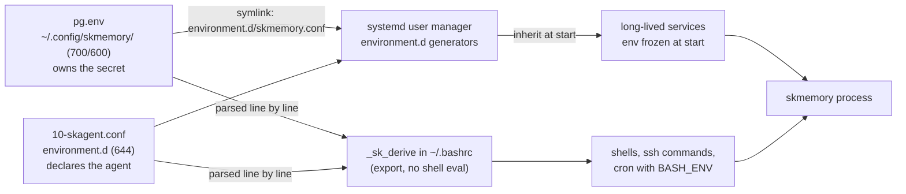
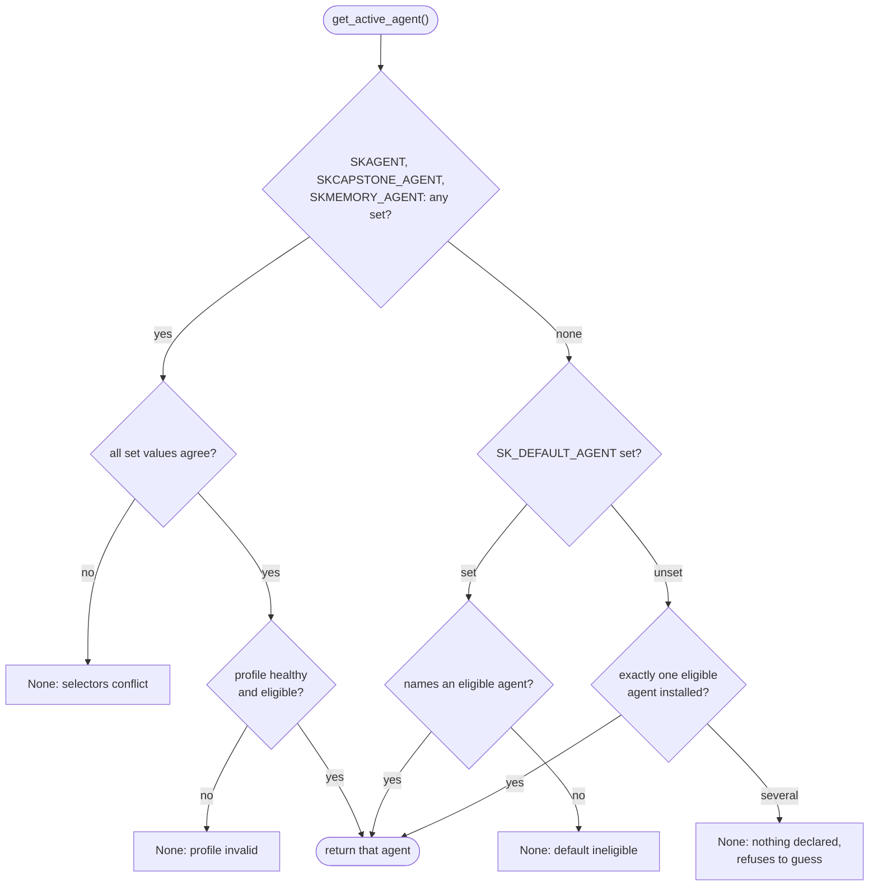
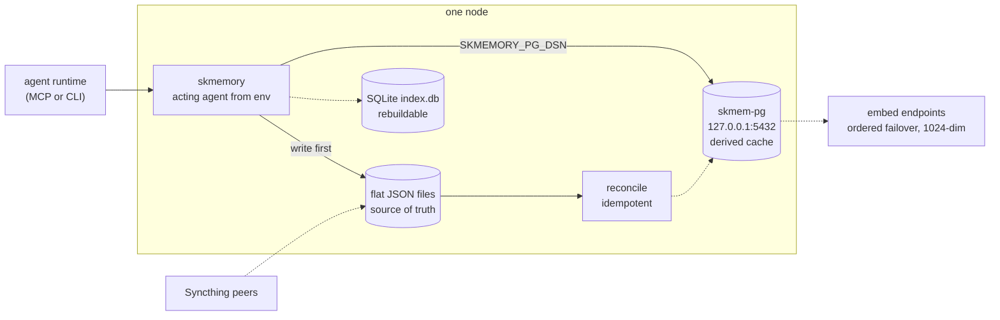

# skmemory Node Configuration Standard

How every `sk*` node configures **skmemory** (the memory stack: skmem-pg, the embed
endpoints, and the acting agent) so that a node can never quietly serve the wrong
memories, or serve the right ones with the wrong search, while reporting nothing wrong.

The governing principle: **derive, never paste.** Any configuration value that
exists in two places will drift, and the drift is silent. One file owns each value;
everything else reads that file. A node is correct when it is correct for services,
for shells, and across a reboot, from files, with no step that lives only in a
running process.

This standard governs skmemory node configuration. Where services are supervised and
restarted it defers to [SERVICE_UNIT_STANDARD](./SERVICE_UNIT_STANDARD.md); where a
check should run on a schedule it defers to
[OBSERVABILITY_AND_SCHEDULING_STANDARD](./OBSERVABILITY_AND_SCHEDULING_STANDARD.md).

Reference implementation: the noroc2027 and `.41` remediation of 2026-11-06 (the
agent resolver is `skmemory/agents.py:get_active_agent()`), and the interactive
diagrams under
[`reference/skmemory-node-config/diagrams/`](../reference/skmemory-node-config/diagrams/).

---

## 0. The incident this standard exists to prevent

A two-estate investigation (verified 2026-11-06 across the nor estate) found skmemory
**silently serving a near-empty template store with keyword-only search while
reporting nothing wrong**. Three distinct configuration defects, each now fixed on
noroc2027 and `192.168.0.41`:

| # | Defect | Symptom | Rule it breaks |
|---|---|---|---|
| 1 | **The credential existed as several pasted copies.** `~/.config/environment.d/skmemory.conf` held the PG password, and `~/.bashrc` had held its own pasted copy. The password rotation of 2026-10-25 updated the canonical file and left every long-lived process authenticating with the OLD secret. `.41` also had an orphaned `~/.config/skmemory/pg.env` that nothing loaded and that disagreed with the live value about which database to use. | `vector_ok: null` and keyword-only search, for days, with no error anywhere a human would look. | Section 1, Section 4 |
| 2 | **The acting agent was set imperatively, not declared.** On noroc2027, `SKAGENT`, `SKCAPSTONE_AGENT`, `SKMEMORY_AGENT` and `SK_DEFAULT_AGENT` lived ONLY in the systemd user manager's runtime environment, declared in no file, so they were correct until the next manager restart and reproducible on no other node. On `.41` they were absent. With 8 to 13 agent homes installed and nothing declared, `get_active_agent()` correctly returned `None`, but callers downstream degraded to the `lumina-template` home. | `.41` read **367 memories from a template instead of 51,270 from the real home**, and reported its primary backend as `ok: true` while doing it. | Section 2, Section 4 |
| 3 | **`environment.d` is read by the systemd user manager, not by bash.** A node can be correct for services and wrong for shells, cron and `bash -c`, which is exactly the split that existed. | Services healthy, interactive `skmemory health` degraded, or the reverse. | Section 3 |

None of the three raised an error. Each was a correct program reading incorrect or
absent configuration. The resolver's refusal in Defect 2 was right; the configuration
was missing. See [section 6](#6-anti-patterns).

---

## 1. One file owns the node's skmemory stack config, credential included

The node's entire skmemory stack configuration lives in **one file**:

```
~/.config/skmemory/pg.env      directory mode 700, file mode 600
```

It holds exactly these keys:

| Key | Meaning |
|---|---|
| `SKMEMORY_VECTOR_BACKEND` | `pgvector` on a node that runs skmem-pg. Forces the sovereign Postgres path so nothing falls back to the legacy Chroma plus local-embedder stack. |
| `SKMEMORY_PG_DSN` | The node-local skmem-pg DSN, **with the password**. The only place the password is written. |
| `SKMEMORY_EMBED_URL` | Primary embed endpoint. |
| `SKMEMORY_EMBED_URLS` | Comma-separated embed endpoints, tried in order (failover). |
| `SKMEMORY_EMBED_MODEL` | `mxbai-embed-large` (1024-dim). Every endpoint in the list MUST serve the same model and dimension, or failover skews search. |

Format: plain `KEY=value` lines and `#` comments. No quoting, no `export`, no
variable expansion, because the same file is read by two parsers (systemd and the
shell helper in section 3) and they only agree on the plain form.

### 1.1 `environment.d/skmemory.conf` is a symlink, not a copy

```bash
mkdir -p ~/.config/skmemory && chmod 700 ~/.config/skmemory
chmod 600 ~/.config/skmemory/pg.env
ln -sfn ~/.config/skmemory/pg.env ~/.config/environment.d/skmemory.conf
```

The systemd user-environment generator **follows symlinks** (verified empirically),
so user services inherit the values with zero duplication of the secret. The
verification command belongs in the standard because a config that "looks right" is
only a claim:

```bash
/usr/lib/systemd/user-environment-generators/30-systemd-environment-d-generator \
  | grep '^SKMEMORY_PG_DSN='
```

Exactly one line MUST print. Zero lines means the symlink is broken or the file is
unreadable; two lines means a second file also sets it (see section 6). Do not paste
that output into a ticket or chat: it contains the password. Use `grep -c` when you
only need to prove presence.

### 1.2 Rotation is a single edit, plus a restart

Rotating the skmem-pg password:

1. `ALTER USER` on skmem-pg.
2. Edit **only** the password slot of `SKMEMORY_PG_DSN` in
   `~/.config/skmemory/pg.env`. Never blind-replace the old password string across
   files: it can also occur in the database name or in paths.
3. Make the user manager re-read `environment.d` (a re-login or a manager restart;
   `daemon-reload` alone does not re-run the generators on every systemd version, so
   confirm with `systemctl --user show-environment | grep -c '^SKMEMORY_PG_DSN='`
   rather than assuming).
4. **Restart every long-lived consumer.** A running process keeps a frozen copy of
   its environment from the moment it started. Editing the file does not change a
   process that is already running.
5. Update the vault entry for the node.
6. Run the section 5 checks.

**Step 4 is the one that was missed on 2026-10-25.** The canonical file was updated
correctly; every process that had started before the rotation kept authenticating
with the old secret. Treat "rotation complete" as "every consumer restarted and the
health probe green", never "file edited".

Do not leave dated backups of `pg.env` or the old `skmemory.conf` next to the live
files. A `.bak` holding the previous secret is a pasted copy that nothing updates.
Move it out of the config directories or delete it.

---

## 2. The acting agent is DECLARED in a file

```
~/.config/environment.d/10-skagent.conf      mode 644
```

```ini
SKAGENT=lumina
SKCAPSTONE_AGENT=lumina
SKMEMORY_AGENT=lumina
SK_DEFAULT_AGENT=lumina
```

All four keys are set to the node's agent: **nor nodes: `lumina`; chi nodes:
`jarvis`.** This file contains no secret, hence mode 644.

Why all four, and why `SK_DEFAULT_AGENT` matters. `get_active_agent()` resolves in
this order and **refuses rather than guessing**:

1. `SKAGENT`, `SKCAPSTONE_AGENT`, `SKMEMORY_AGENT`: any that are set must all name
   the same agent, and that profile must be healthy and eligible. Disagreement
   returns `None`.
2. Otherwise `SK_DEFAULT_AGENT`: the **declared default**. It must name an eligible
   installed agent, or the result is `None`.
3. Otherwise, if exactly one eligible agent is installed, that agent.
4. Otherwise `None`.

There is **no implicit default agent**. With several agents installed and nothing
declared the answer is `None`, and `require_memory_profile()` raises naming the fix.
The refusal is the correct behaviour: the alternative (which an earlier revision
shipped) is to open the alphabetically first agent and silently remember the wrong
life. Declaring the agent in a file is what keeps a node out of the refusal branch.

The four selectors are deliberately set to the same value. Setting only one leaves
the others to disagree with whatever a launcher exports later, and conflicting
selectors also return `None`. A unit's own `Environment=` still overrides this file,
so per-agent template units such as `skmemory-sync@<agent>` keep working. Launching
as another agent for one session (`SKAGENT=jarvis claude`) overrides the file for
that process only, and MUST set all selectors consistently or none, never one.

Diagram: [agent resolution](#72-agent-resolution-decision-path).

---

## 3. Shells derive from the same two files

`environment.d` is read by the **systemd user manager**. A bash process is not a
child of that manager's environment generator, so on its own it sees none of it.
Shells therefore **derive** their environment from the same two files, not from a
third copy.

Put this block in `~/.bashrc`, **above** the non-interactive guard
(`case $- in *i*) ;; *) return;; esac` or `[ -z "$PS1" ] && return`), so that
non-interactive shells that read `.bashrc` also get it:

```bash
_sk_derive() {   # <file> <key-prefix-regex>
  [ -r "$1" ] || return 0
  while IFS= read -r _sk_line; do
    case "$_sk_line" in
      \#*|"") continue ;;
    esac
    printf '%s' "$_sk_line" | grep -qE "^$2=" && export "$_sk_line"
  done < "$1"
  unset _sk_line
}
_sk_derive "$HOME/.config/skmemory/pg.env" 'SKMEMORY_[A-Z_]+'
_sk_derive "$HOME/.config/environment.d/10-skagent.conf" '(SKAGENT|SKCAPSTONE_AGENT|SKMEMORY_AGENT|SK_DEFAULT_AGENT)'
unset -f _sk_derive
```

**Why `export "$line"` and not `set -a; . file`.** Sourcing parses the value as
shell. A password containing `$`, `` ` ``, `;`, `&`, `(`, a quote or a space would be
expanded, split or executed, and a DSN is exactly the kind of string that carries
such characters. `export "$line"` hands the whole `KEY=value` string to `export` as a
single word, so the value is **not shell-parsed** and survives intact. The prefix
regex also means a stray key in the file is ignored instead of exported.

**Where it runs.** Bash reads `~/.bashrc` for interactive shells, for non-interactive
shells it is told to read it (`BASH_ENV=$HOME/.bashrc`), and for commands run over
`ssh`. A bare `bash -c` or a cron job started from `cron` does **not** read
`.bashrc` at all (verified: `env -i HOME=$HOME bash -c 'echo "$SKAGENT"'` prints
nothing; with `BASH_ENV=$HOME/.bashrc` it prints the agent). So:

- Any cron entry or script that touches skmemory MUST set
  `BASH_ENV=$HOME/.bashrc` (in the crontab, or in the script's own invocation), or
  source the two files itself. Placing the block above the guard only helps shells
  that read `.bashrc` in the first place.
- Wrap scheduled jobs per
  [OBSERVABILITY_AND_SCHEDULING_STANDARD](./OBSERVABILITY_AND_SCHEDULING_STANDARD.md)
  so a job that ran with an empty environment fails visibly instead of degrading.

Diagram: [config resolution](#71-config-resolution-flow).

---

## 4. The rule the three defects share: derive, never paste

> **Normative.** A configuration value MUST have exactly one owning file. Every other
> consumer MUST derive it from that file (symlink, parse, or read at start). A value
> MUST NOT be copied into a second file, a shell rc, a unit `Environment=` line, a
> `~/.claude.json` `env` block, a wrapper script, or a running process's imperative
> environment.

The three defects are three cases of one failure:

| Defect | The copy | The drift |
|---|---|---|
| 1 | A pasted password in `~/.bashrc`, an orphaned `pg.env` | A rotation updated one copy. Processes holding another authenticated with the old secret, silently. |
| 2 | The agent lived only in the user manager's runtime environment | The "copy" was the running process. It matched until the manager restarted, and matched on no other node. |
| 3 | Services and shells read different mechanisms | Two readers, no shared source. Each was right by its own lights. |

The corollary for reviewers: **if you find yourself writing a value a second time, you
have found the bug.** Replace the second occurrence with a derivation.

Known sibling to clean up on a node that still has it: a second embed file such as
`50-skmemory-embed.conf` repeats `SKMEMORY_EMBED_URL(S)` and adds the legacy
`EMBED_URL`. `environment.d` applies files in lexical order and the later file wins,
so the duplicate is currently masked, which is exactly the condition under which a
future edit to one file changes nothing. Fold anything still needed into `pg.env` and
remove the duplicate.

---

## 5. Verification, as runnable commands

A node is compliant **only when all of these pass.** Run them after any rotation,
agent change, reboot, or install, and put the first three in the node's health check.

```bash
# 1. A fresh interactive shell has the right agent, backend, and a set DSN.
bash -ic 'echo "SKAGENT=$SKAGENT backend=$SKMEMORY_VECTOR_BACKEND dsn=${SKMEMORY_PG_DSN:+set}"'
#    expect: SKAGENT=<the node agent> backend=pgvector dsn=set

# 2. The resolver names the node's agent, not None.
python -c "from skmemory.agents import get_active_agent; print(get_active_agent())"
#    expect: the node's agent (lumina on nor nodes, jarvis on chi nodes)

# 3. The services' view agrees (generator output; prints the password, so count it).
/usr/lib/systemd/user-environment-generators/30-systemd-environment-d-generator \
  | grep -c '^SKMEMORY_PG_DSN='
#    expect: 1

# 4. Health.
skmemory health
#    expect: status: ok
#            base_path under the real agent home (~/.skcapstone/agents/<agent>/...),
#            never one ending -template
#            embed_ok: true, vector_ok: true, graph_ok: true
```

If `python` is not the skmemory interpreter, use `~/.skenv/bin/python`.

### 5.1 Reading the output honestly

- **`vector_ok: null` (or `embed_ok` / `graph_ok` null) means the probe did not run.
  It does NOT mean it passed.** Search has silently fallen back to keyword-only. This
  is the exact symptom of Defect 1. Treat `null` as a failure.
- **A `base_path` ending in `-template` means the node is reading a scaffold**, not
  its memories. This is the exact symptom of Defect 2 (367 template memories instead
  of 51,270). `status: ok` alongside a template path is the dangerous combination,
  because the backend answered correctly for the wrong home.
- `get_active_agent()` printing `None` is the resolver working. The defect is the
  missing declaration (section 2), and `require_memory_profile()` names the fix.
- Prove the check can fail. Temporarily unset the declaration in a throwaway
  environment (`env -i HOME=$HOME python -c ...`) and confirm check 2 prints `None`,
  so you know it is not a check that cannot go red.

---

## 6. Anti-patterns

| Anti-pattern | Why it fails |
|---|---|
| The DSN or password pasted into `~/.bashrc`, a unit `Environment=`, `~/.claude.json`, or a wrapper | A second copy. A rotation misses it and nothing errors. |
| A `pg.env` that nothing loads | A decoy. It disagrees with the live value and an operator "fixes" the wrong file. If `pg.env` exists it MUST be the owner and `skmemory.conf` MUST point at it. |
| `SKAGENT` etc. exported by hand into the user manager (`systemctl --user set-environment`) | Correct until the manager restarts, declared nowhere, reproducible on no other node. |
| Setting only `SKAGENT` | The other selectors can still disagree with a launcher, and disagreement returns `None`. |
| Relying on an implicit default agent | There is none. Several agents and nothing declared is `None` by design. |
| Caller treats `None` as "use the template" | Opens `lumina-template` and reports success. This is how `.41` read 367 instead of 51,270. A caller that gets no agent MUST stop. |
| `set -a; . pg.env` in a shell | Shell-parses the password. Use the `_sk_derive` form. |
| Editing the file and calling the rotation done | Running processes keep the old environment. Restart every consumer. |
| Reading `status: ok` as healthy | `ok` with `-template` in `base_path`, or with null probes, is not healthy. |
| Dated `.bak` copies of the old env next to the live files | An unmanaged copy of the previous secret. |

---

## 7. Architecture diagrams

Per [ARCHITECTURE_AND_DATAFLOW_STANDARD](./ARCHITECTURE_AND_DATAFLOW_STANDARD.md),
mermaid is canonical and renders inline. The interactive Archify companion (JSON
source plus generated HTML, committed together) is linked beside each diagram.

### 7.1 Config resolution flow

Two declarative files, read by the systemd user manager and by bash, ending in the
skmemory process. Interactive companion:
[`config-resolution.architecture.html`](../reference/skmemory-node-config/diagrams/config-resolution.architecture.html)
(source: [`.json`](../reference/skmemory-node-config/diagrams/config-resolution.architecture.json)).



### 7.2 Agent resolution decision path

`get_active_agent()` including the refusal branches. Interactive companion:
[`agent-resolution.workflow.html`](../reference/skmemory-node-config/diagrams/agent-resolution.workflow.html)
(source: [`.json`](../reference/skmemory-node-config/diagrams/agent-resolution.workflow.json)).



### 7.3 Node topology

How a node's skmemory relates to skmem-pg, the embed endpoints and the
Syncthing-synced flat files. Interactive companion:
[`node-topology.architecture.html`](../reference/skmemory-node-config/diagrams/node-topology.architecture.html)
(source: [`.json`](../reference/skmemory-node-config/diagrams/node-topology.architecture.json)).



Flat files are the only source of truth. skmem-pg is a per-node derived cache, so a
wrong DSN degrades search on that node without losing data, which is why the
degradation is silent and why section 5 exists.

### 7.4 Regenerating the companions

Use the pinned install and the update check disabled, as in
[`archify-diagrams.md`](./archify-diagrams.md#3-regenerating-locally):

```bash
ARCHIFY_UPDATE_CHECK_DISABLED=1 node bin/archify.mjs finalize architecture \
  reference/skmemory-node-config/diagrams/config-resolution.architecture.json \
  reference/skmemory-node-config/diagrams/config-resolution.architecture.html \
  --quality showcase --json
```

Regenerate in the same PR that changes the mermaid above. The mermaid is canonical;
a companion that outlives it is worse than none.

---

## Compliance line (put in your SOP + README)

> **skmemory node config:** one owning file `~/.config/skmemory/pg.env` (dir 700, file
> 600) holds the stack config and the credential, `environment.d/skmemory.conf` is a
> symlink to it, the acting agent is declared in `environment.d/10-skagent.conf`
> (all four selectors), shells derive both via `_sk_derive`, and no value is pasted
> in a second place. Rotation restarts every long-lived consumer. `bash -ic`,
> `get_active_agent()` and `skmemory health` (ok, non-template `base_path`, all probes
> true) pass. Conforms to
> [SKMEMORY_NODE_CONFIG_STANDARD](https://github.com/smilinTux/sk-standards/blob/main/standards/SKMEMORY_NODE_CONFIG_STANDARD.md).

Not applicable (`N/A: <reason>`) only for repos and nodes that **do not run or call
skmemory**.

## Related standards

- [SERVICE_UNIT_STANDARD](./SERVICE_UNIT_STANDARD.md): restarting consumers after a
  rotation, and unit `Environment=` precedence.
- [OBSERVABILITY_AND_SCHEDULING_STANDARD](./OBSERVABILITY_AND_SCHEDULING_STANDARD.md):
  wrap the section 5 checks as a scheduled job so a drifted node alerts.
- [ARCHITECTURE_AND_DATAFLOW_STANDARD](./ARCHITECTURE_AND_DATAFLOW_STANDARD.md) and
  [archify-diagrams.md](./archify-diagrams.md): how the diagrams are authored and kept honest.
- [BACKUP_AND_RETENTION_STANDARD](./BACKUP_AND_RETENTION_STANDARD.md): flat files are
  the archive target, skmem-pg and indexes are rebuildable.
