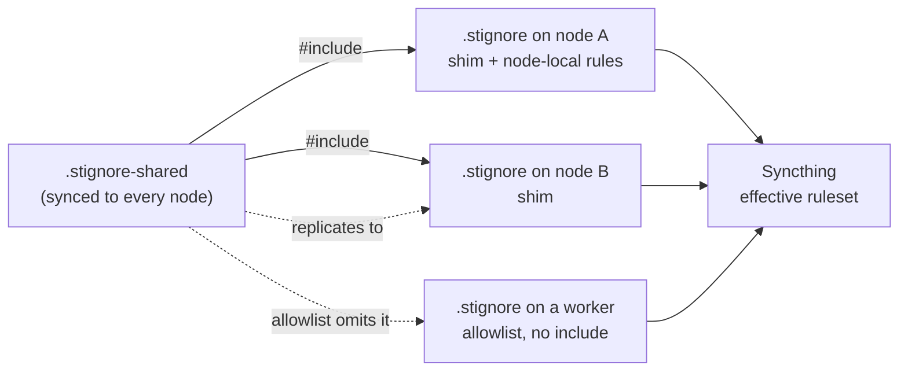

# Syncthing Ignore Standard

How every `sk*` node that shares the sovereign folder over **Syncthing** keeps its
ignore rules, so that a secret can never replicate because one node's copy of the rules
was older than another's, and so that per-host runtime files stop generating conflict
copies.

The governing principle: **the rules live in one synced file, and `.stignore` is a
shim that includes it.** Syncthing never synchronizes `.stignore`, so any rule kept
only there exists once per node and drifts silently. A rule that must hold everywhere is
written once, in a file that does replicate.

This standard governs the ignore rules of the shared sovereign folder (`~/.skcapstone`
on every node). It does not govern what the folder contains: see
[BACKUP_AND_RETENTION_STANDARD](./BACKUP_AND_RETENTION_STANDARD.md) for which state is
sovereign and which is rebuildable, and
[SKMEMORY_NODE_CONFIG_STANDARD](./SKMEMORY_NODE_CONFIG_STANDARD.md) for the companion
rule that credentials live outside the synced tree altogether. Where a check should run
on a schedule it defers to
[OBSERVABILITY_AND_SCHEDULING_STANDARD](./OBSERVABILITY_AND_SCHEDULING_STANDARD.md).

Reference implementation: `skcapstone` (`stignore_layout.py` for the installer and the
checks, `defaults/.stignore-shared` and `defaults/.stignore` as package data, and the
`sync` category of `skcapstone doctor`).

---

## 0. The incident this standard exists to prevent

A hand remediation of two nodes' ignore files found three defects that all came from the
same cause: the rules were per-node files, and Syncthing does not replicate them.

| # | Defect | Symptom | Rule it breaks |
|---|---|---|---|
| 1 | **The per-node `.stignore` copies had drifted.** One node carried a `/secrets` rule (added when a backup credential directory appeared under the sovereign root) and the other did not. | A directory of credentials was protected on one node and exposed to replication on the other. Nothing reported the difference, because each file was correct for the node that held it. | Section 1, Section 5 |
| 2 | **Derived outputs of per-host daemons were synced.** A daemon on every node rewrites its own digest, health and pattern files every half hour, so every node replicated its version to every other. | About ten conflict copies a day for one file, and the real file was a coin toss. | Section 3 (derived outputs) |
| 3 | **Earlier incidents had each been fixed by adding one line to one node's file.** A live token reached every node through a synced `*.env`; a `.bak` copy of a secret then slipped past a rule that matched only the suffix; lock files produced a stream of "no such file" log lines on the peer. Each fix existed on whichever node it was made on. | The fix for a leak was as strong as the number of nodes someone remembered to edit. | Section 5 |

None of the three raised an error. Each node's file was valid; the fleet's rules were
not one set of rules.

---

## 1. The layout: a shim and one shared file

Two files at the root of the synced folder:

```
<root>/.stignore          the shim: per-node, NEVER synced by Syncthing
<root>/.stignore-shared   the rules: a normal file, so it IS synced to every node
```

The shim is exactly three lines on a node with no node-local rules:

```
// Node-local ignore rules. Shared rules live in .stignore-shared (synced).
// Add a rule here only if it must apply to THIS node alone.
#include .stignore-shared
```

How Syncthing reads it, and why each point matters here:

- `#include` pulls the other file's patterns in **at that position**. Order is
  preserved, and Syncthing is **first-match-wins**, so the include line's position is
  part of the meaning. Node-local rules go **below** it.
- Both files sit side by side at the folder root. Do not include a file from outside the
  folder.
- `.stignore-shared` is a leaf: it holds patterns and comments, no `#include` of its own.
- It holds **only ignore rules**. No `!` negations (their effect depends on order, and a
  shared file's order is edited by many hands), and no per-node content.



---

## 2. What belongs in the shared file and what stays node-local

**Shared** (`.stignore-shared`) is the default. A rule belongs there when its reason
holds on every node. The test: *would I copy this rule to the next node I set up?* If
yes, it is shared. That covers every class in section 3.

**Node-local** (`.stignore`, below the include) is for a path that exists, or must be
withheld, on **this host alone**: a scratch mount, a directory a single host produces
and no other should ever see, a host-specific agent home that is deliberately not
replicated. Keep this list short. A node-local rule is the exact thing that drifted in
section 0, so every line there should have a comment saying why it is not shared.

| Question | Answer |
|---|---|
| Does the reason apply to every node? | Shared. |
| Does it only matter because of something installed on this one host? | Node-local, with a comment. |
| Is it a secret class? | Always shared. A secret rule that exists on some nodes is a leak on the others. |
| Not sure? | Shared. Ignoring more costs a file that does not replicate; ignoring less leaks a key or floods the mesh. |

**Union is the only safe direction.** A tool or a person may add a rule. Nothing may
remove a shared rule to make a node "work": a rule is deleted only by editing the shared
file on purpose, with the incident it was bought by removed from its comment first.

---

## 3. The rule classes

Every rule in the shared file belongs to one of five classes, and the comment above it
says which incident bought it. A rule without a comment is the first one to be deleted
by the next person who does not understand it.

| Class | What it is | Examples | Test | `(?d)`? |
|---|---|---|---|---|
| **Never-replicate secrets** | Private keys, credentials, token stores, and any copy of them. | `*.key`, `*.pem`, `**/private.*`, `*.env`, `*.env.*`, `config/*.env`, `/secrets`, revocation certificates, passphrase files, secret keyrings, the signature roster | Would a peer holding this be able to act as this node or read its credentials? | **Never.** `(?d)` lets Syncthing delete an ignored file that blocks a directory removal. Never put it on something that must survive. |
| **Per-host runtime state** | Files that more than one node writes at the same path, each with its own value. | daemon pid and shutdown state, per-host trust snapshots, audit logs, `**/logs/*.log`, the per-run ledger, retry queues, a messenger session | Do two nodes write this exact path? If yes, it conflicts. | Only for atomic-write temporaries. |
| **Derived outputs** | Anything a peer can rebuild from synced source-of-truth files. | local SQLite indexes and their `-wal`/`-shm`, a retired vector store, a daemon's digest, health and pattern files, memory archives | Can this be regenerated from files that DO replicate? If yes, replicating it only races the rebuild. | No. |
| **Locks** | Kernel-local advisory locks. | `(?d)**/*.lock` | `flock` state never crosses hosts, so replicating the file is noise at best. | **Yes**: a lock file is disposable. |
| **Caches and debris** | Platform metadata, build or interpreter caches, and local-only debris. | `__pycache__`, `*.pyc`, `venv`, `.venv`, `.cache`, `**/*.pid`, `**/*.sync-conflict-*`, `.DS_Store`, `Thumbs.db`, `(?d)*.tmp`, `.stversions`, backup copies of the ruleset (`.stignore.bak-*`) | Is it regenerable and meaningless on another host? | For temporaries and locks, yes. |

Three rules of thumb that decide the hard cases:

1. **Match the stem, not just the suffix.** A secret rule that only matches `*.env`
   missed `autopilot.env.bak-<stamp>` and a live token replicated. Write `*.env` **and**
   `*.env.*`.
2. **Prefer partitioning to ignoring.** If every node needs to see every node's value
   (an activity journal), do not ignore the file: make the path unique per node
   (`<dir>/<node>/...`) so no two nodes ever write the same file. Ignoring hides the
   data; partitioning removes the conflict and keeps it.
3. **A broad ignore needs a counter-check.** `logs` ignores every directory named
   `logs`, including one that holds source-of-truth. Prefer the narrow pattern
   (`**/logs/*.log`) and check the source-of-truth tree is still replicated (section 7).

### 3.1 Considered, not shared

An earlier packaged template carried more rules than the live reference. Four were kept
in the canonical shared file, each with a reason comment: `**/*.sync-conflict-*`
(conflict copies stay local and never cascade into conflicts of conflicts, and existing
ones are still reported by check C5), `**/*.pid` (a process id means nothing on another
host), `.cache` and `.venv` (per-host, regenerable).

The rest were **considered and deliberately not shared**, because the live reference does
not carry them and adopting this layout must not change what replicates:

| Rule | Why it is not in the shared file |
|---|---|
| `logs` (blanket) | Ignores every directory named `logs`, including any that holds source of truth. The narrow `**/logs/*.log` is shared instead. |
| `.git` | A repository inside the folder may be carried by Syncthing today. Ignoring it would change that. |
| `heartbeats/`, `metrics/` | The live reference ignores the root `/heartbeats` and `metrics/daily` only. The blanket forms would hide more than it does. |
| `deadletter`, `processing` | Local comms staging; the live reference does not ignore them, so live behaviour stays as it is. |
| `fleet/workspaces`, `**/dreaming-state.json`, `**/fallbacks.json`, `**/.last_checkpoint` | Not ignored by the live reference. Add one to the shared file (section 5) if it is shown to conflict, with the incident in its comment. |

Considering a rule and leaving it out is a decision, not an omission: this list is where
the next person looks before re-adding one.

The source of truth is never in this file: memory tiers, soul, seeds, the journal, trust
records and the coordination board replicate, by omission.

---

## 4. The worker allowlist variant

A node that holds **no sovereign state** (a model-serving box, a monitoring-only member)
must not replicate the folder. Listing everything to ignore would be a long, drifting
list; the safe form is the reverse: **ignore everything, then allow the few paths the
node needs.** That is an allowlist `.stignore`, and it is a recognised variant of this
standard, not a violation of it.

```
// never-replicate rules FIRST: first match wins, so they must precede the allowlist
*.key
*.pem
**/private.*
*.env
*.env.*
config/*.env
(?d)**/*.lock

// the allowlist: only what this node needs
!/fleet
!/fleet/**
!/config
!/config/**

// close it
**
```

Rules for the variant:

| # | Rule |
|---|---|
| W1 | The never-replicate rules (`*.key`, `*.pem`, `**/private.*`, `*.env`) come **before the first `!`**. An allowlisted directory such as `config/` or `capauth/` still holds secrets, and first match wins, so a rule below the allowlist never sees them. |
| W2 | The allowlist is **closed by a catch-all `**` as its last effective rule.** An allowlist without it ignores nothing. |
| W3 | Every rule sits **above** the `**`. Anything below it is unreachable: it reads as protection and does nothing. (Found in practice: a block of per-host rules left below the catch-all.) Move it above or delete it. |
| W4 | The variant has **no `#include`.** `.stignore-shared` is not on the allowlist, so it is never replicated to the node, and an include of a file that is not there errors the folder (section 6). |
| W5 | Allow only the paths the node needs, and say in a header comment what the node is and why it needs them. |

A node is classified as this variant when its `.stignore` has no include, has at least
one `!/` rule and a bare `**`. Anything else without an include is a **legacy**
`.stignore` (a full pasted ruleset), which is the layout this standard replaces.

---

## 5. How to add a rule

Edit **`.stignore-shared` once.** It replicates; every node's shim includes it; the rule
applies everywhere on the next scan.

1. Put the rule in the class it belongs to (section 3), with a comment naming the
   incident and the date.
2. If it is a secret rule, check it with the probe in section 7 before relying on it.
3. Do **not** also paste it into any node's `.stignore`. Two copies is the defect.
4. Update the packaged canonical copy in the same change, so a node installed next month
   starts with it and the drift check stays quiet.
5. For a worker, add the rule to its `.stignore` **above the allowlist**: the worker does
   not receive the shared file.

A rule that must apply to one node only goes in that node's `.stignore`, **below** the
include, with a comment saying why it is not shared.

---

## 6. Install order and the failure mode

**If `.stignore-shared` is missing, Syncthing errors the folder.** An `#include` of a
file that does not exist makes the ignore patterns fail to load, and the folder does not
sync until it exists. So the install rules are about order:

1. **Write `.stignore-shared` first**, only if it is absent. Never overwrite an existing
   one: on a node joining a mesh it may already have arrived by sync.
2. **Then write the shim**, only if `.stignore` is absent. Never write a shim over a
   missing shared file.
3. Writes are atomic (a temporary sibling, then rename), so Syncthing never reads half a
   file.
4. An existing **shim** is left untouched. An existing **worker** allowlist is left
   untouched, and no shared file is created for it.
5. An existing **legacy** `.stignore` is never overwritten. The installer backs it up
   (one backup per distinct content, so a daemon that runs the installer on every start
   does not litter), reports what the node would gain and which of its rules the shared
   file lacks, and leaves the file as it is. An explicit **migrate** step rewrites it as
   a shim and keeps every legacy rule not already in the shared file, with its comment,
   below the include. A legacy file containing a `!` rule is **not** migrated
   automatically: order decides whether a negation applies, so it is rearranged by hand.

A node that joins an existing mesh creates its own `.stignore-shared` at install time so
the folder never errors; when the mesh's copy arrives, identical content converges
silently and different content may leave one conflict copy, which the checks in section 7
report.

Because the shared file replicates, **any peer can edit it for everyone.** That is why the
checks in section 7 read the effective ruleset and compare it to the packaged canonical
file instead of trusting that "the shared file is there".

---

## 7. Verification

Conformance checks (a node passes when every one holds):

| # | Check | Severity |
|---|---|---|
| C1 | `.stignore` is a shim (it contains `#include .stignore-shared`) or the worker variant. | error |
| C2 | `.stignore-shared` exists on every non-worker node. | error |
| C3 | `.stignore-shared` equals the packaged canonical version. | warn, **report only** |
| C4 | Every critical rule is present in the **effective** ruleset: `/secrets`, `*.key`, `*.pem`, `**/private.*`, `*.env`, `config/*.env`, and the derived outputs of any per-host daemon in the estate (for the memory stack: its state, digest, health and pattern files). For a worker, the secret rules precede the first `!`. | error |
| C5 | No `*.sync-conflict-*` files under the folder. Report the count and the paths; never delete automatically, because the authoritative copy is chosen per file. | warn, **report only** |

Read the **effective** rules from the Syncthing daemon where it is reachable, because
that is what is enforced, and fall back to parsing the two files:

```bash
# <folder-id> is the folder's id in the Syncthing config; the key stays in the environment
curl -s -H "X-API-Key: $SYNCTHING_API_KEY" \
  "http://127.0.0.1:8384/rest/db/ignores?folder=<folder-id>"
```

The response lists the rules with every include expanded under `expanded`, and reports
an error when the patterns failed to load (the missing-include failure of section 6). Syncthing reports each rule in more than one expanded form (`*.key`, `**/*.key`,
`*.key/**`), so compare by the rule's stem and not by exact string. Send the API key only
to a loopback address, and do not paste the response into a ticket without checking it.

A probe for a secret rule, run before trusting it: create a throwaway file of the shape
the rule is meant to catch **in a scratch copy of the folder layout**, not in the live
folder, and confirm the daemon (or a pattern evaluator) reports it ignored. A rule that
"looks right" is a claim; the probe is the evidence.

Reference implementation: `skcapstone doctor`, category `sync`, checks
`sync:stignore-shim` (C1), `sync:stignore-shared` (C2), `sync:stignore-shared-drift` (C3),
`sync:stignore-critical-rules` (C4) and `sync:conflicts` (C5). None of them writes a file.

---

## 8. Anti-patterns

| Anti-pattern | Why it fails |
|---|---|
| A full ruleset in each node's `.stignore` | The file is never synced, so the copies drift. This is the layout the standard replaces. |
| Fixing a leak by adding the rule to one node | The fix is as strong as the number of nodes someone remembered. Edit the shared file. |
| A shim that includes a file the installer did not create first | The folder errors until the file exists. |
| `(?d)` on a secret rule | A rule that may delete the file it protects. `(?d)` is for locks and temporaries only. |
| Matching `*.env` but not `*.env.*` | A `.bak` copy of a secret is still a secret. |
| Rules below a worker's catch-all `**` | They never apply, and read as protection. |
| Ignoring a directory of per-node values that other nodes need to read | Ignoring hides the data. Partition the path per node instead. |
| A `!` negation in the shared file | Its effect depends on order, and the shared file is edited by many hands. |
| An un-commented rule | The next person deletes it. The comment is the only record of the incident. |
| Overwriting a node's `.stignore` from a template | A node's rules are incident history. Union, back up and report; never overwrite. |

---

## Compliance line (put in your SOP + README)

> **Syncthing ignore rules:** the shared sovereign folder's rules live in the synced
> `.stignore-shared`; every node's `.stignore` is a shim that includes it (node-local rules
> below the include, each with a comment), or the documented worker allowlist with its
> secret rules above the first `!`. The installer writes the shared file first, never
> overwrites an existing `.stignore`, and backs up and reports a legacy one. The doctor
> checks C1 to C5 against the effective ruleset. Conforms to
> [SYNCTHING_IGNORE_STANDARD](https://github.com/smilinTux/sk-standards/blob/main/standards/SYNCTHING_IGNORE_STANDARD.md).

Not applicable (`N/A: <reason>`) only for repos and nodes that **do not share a folder
over Syncthing**.

## Related standards

- [SKMEMORY_NODE_CONFIG_STANDARD](./SKMEMORY_NODE_CONFIG_STANDARD.md): credentials belong
  outside the synced tree; this standard is the backstop for when one lands inside it.
- [BACKUP_AND_RETENTION_STANDARD](./BACKUP_AND_RETENTION_STANDARD.md): flat files are the
  source of truth, indexes and derived outputs are rebuildable (the "derived outputs"
  class).
- [OBSERVABILITY_AND_SCHEDULING_STANDARD](./OBSERVABILITY_AND_SCHEDULING_STANDARD.md): wrap
  the section 7 checks as a scheduled job so a drifted node alerts.
